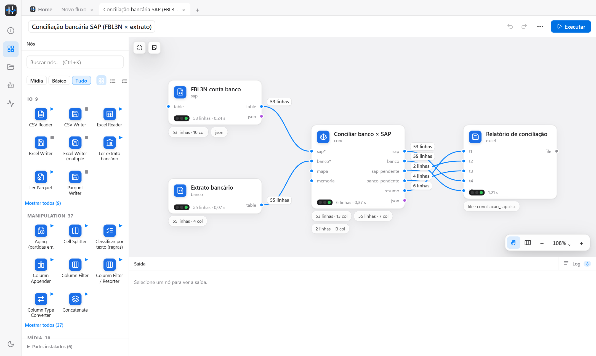
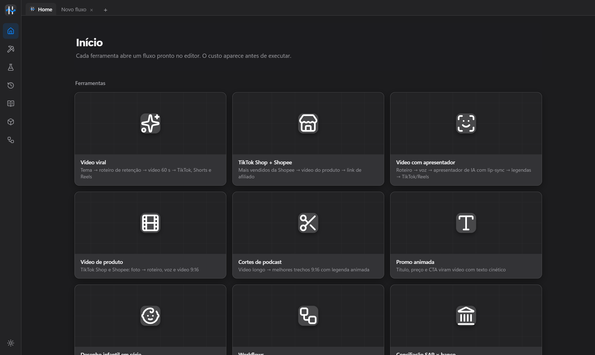

  

<h1 align="center">Trama</h1>

  Ligue os nós e deixe o trabalho repetitivo rodar sozinho: planilhas, SAP, conciliações, relatórios, IA e vídeo. 
  Download e atualizações.

  
  
  

## O que ele faz

| | |
|---|---|
| **Dados** | Lê Excel, CSV, Parquet e exportações do SAP; filtra, junta, agrupa, calcula colunas e grava o resultado em Excel com várias abas. |
| **Finanças** | Conciliação razão × extrato (OFX, CNAB 240, CSV), aging de clientes e fornecedores, lançamentos sugeridos no modelo da empresa. |
| **IA** | Usa a assinatura que você já tem (Claude, Codex, Grok, Gemini) ou as suas chaves de API para roteiros, resumos e textos. O custo aparece antes de executar. |
| **Vídeo** | Roteiro narrado em português, imagens por cena, legendas e exportação para TikTok, Shorts e Reels. |
| **Rotina** | Agende um fluxo para rodar todo dia no horário escolhido. Cada nó mostra o tempo, as linhas e o que deu certo ou errado. |

Tudo roda no seu computador: os arquivos não saem da máquina. Os fluxos ficam salvos como arquivos `.trama`, organizados em pastas.

## Instalar

1. Baixe o **TramaSetup-x.y.z.exe** na [última versão](https://github.com/HenioSampaio/trama-versoes/releases/latest).
2. Abra. Se aparecer *"O Windows protegeu o computador"*, clique em **Mais informações → Executar assim mesmo**.
3. Siga o instalador (não pede administrador). O Trama abre no fim e fica no menu Iniciar.

## Atualizar

O próprio programa busca as versões novas aqui: **⋯ → Procurar atualizações → Atualizar agora**.
Ele baixa, instala por cima e reabre. Seus fluxos e configurações (`%USERPROFILE%\.trama`) não são tocados.

## Versões

O que mudou em cada versão está na página de cada [release](https://github.com/HenioSampaio/trama-versoes/releases).
